# Hi, aku Bagas

<table>
<tr>
<td colspan="2">
<pre>
┌ bagasadh
└› fastfetch
</pre>
</td>
</tr>
<tr>
<td valign="middle"></td>
<td>
<pre>
┌────────────────────────────────────────────────────────┐
│ OS                                      CachyOS x86_64 │
│ Kernel                           Linux 7.3.3-1-cachyos │
│ Packages                                 1409 (pacman) │
│ Shell                                             fish │
│ Desktop Environment                   KDE Plasma 6.8.2 │
│ Window Manager                          KWin (Wayland) │
│ Terminal                                  kitty 0.49.2 │
│ Terminal Font          JetBrainsMonoNFM-Regular (11pt) │
├────────────────────────────────────────────────────────┤
│ Host                        20L6S4KD00 (ThinkPad T480) │
│ CPU          Intel(R) Core(TM) i5-8250U (8) @ 3.40 GHz │
│ GPU     Intel UHD Graphics 620 @ 1.10 GHz [Integrated] │
│ Memory                                        7.64 GiB │
│ Disk (/)                            226.94 GiB - btrfs │
├────────────────────────────────────────────────────────┤
│ Student                          Universitas Gunadarma │
└────────────────────────────────────────────────────────┘
</pre>
</td>
</tr>
</table>

Mahasiswa Teknik Informatika Universitas Gunadarma (semester 5).

## Yang sedang kukerjakan
- ReHub: proyek kelas PemWeb
- lokaloka: proyek kelas IMK
